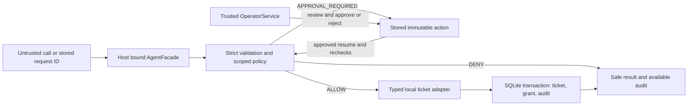

# Architecture and decision boundaries

The host binds a persisted session and exposes `AgentFacade.submit(call)` and `resume(request_id)`. Untrusted input can select only a registered tool and its exact typed arguments. Host code owns the workspace, session, policy, clock, tool registry and separate `OperatorService`. Python name mangling keeps the supported interface small; it is not an isolation mechanism.

## Modules

| Module | Responsibility |
| --- | --- |
| `contracts.py` | Strict JSON, bounded typed calls/finite policy, canonical encoding and digest. |
| `workspace.py` | Trusted new-workspace fixture initialization and persisted session. |
| `gateway.py` | Authority decisions, exact-action approval, expiry/drift checks, transaction orchestration and safe errors. |
| `tools.py` | Two fixed local SQLite adapters using tenant/project/id and expected version. |
| `store.py` | Schema version 1, connections, explicit transactions and ordered audit export. |
| `harness.py`, `mock_agent.py` | Bounded fresh scripted mock subprocess exchange and asserting demonstration. |
| `cli.py` | Trusted host/operator CLI; JSON request files remain untrusted. |
| `scripts/` | Review/CI verifier and documented local operator journey; no runtime feature extension. |

## Submit, approve and resume

Submit validates the call, reads and validates policy, acquires `BEGIN IMMEDIATE`, then obtains authority time and loads the real session and resource. Scope uses the session tenant and exact project; mutations must match the stored version. Winning rule IDs are returned in deterministic sorted order. DENY does not invoke an adapter. ALLOW executes a typed adapter inside that transaction. APPROVAL_REQUIRED stores a copied canonical action and random request ID as PENDING with no dispatch.

Operator review returns that exact action, fingerprint, policy digest, state and deadlines. Approval requires the reviewed fingerprint, a live unchanged session, unchanged policy/action, current resource version and valid pending deadline. It changes the state to APPROVED and appends operator audit without invoking a tool. Reject changes a reviewed PENDING request to REJECTED; it requires the exact fingerprint but does not require a live session, because it only disposes of a request. Inspection itself does not expire or authorize a request.

Resume takes only the stored ID under the host-bound session. It loads a fresh validated policy, then locks and rechecks session, ownership, state, action digest, policy digest, scope/version and deadlines. A foreign request returns generic REQUEST_UNAVAILABLE. A consumed request returns APPROVAL_CONSUMED. Pending without approval returns APPROVAL_REQUIRED. Expiry/drift can terminate the stored action as FAILED. The original stored arguments cannot be replaced on resume.

The validated policy snapshot acquired for submit/approve/resume is its decision boundary. Canonical policy list order contributes to the digest; reordering rules, including an otherwise equivalent policy, invalidates prior approval. Policy edits after snapshot acquisition do not retroactively revoke an already executing call. Host clock checks run after locking and again immediately before adapter dispatch. They control permission to start, not interruption of execution.

## Local commit and failure semantics

The database has sessions, tickets, requests and audit tables; tickets use a compound tenant/project/id primary key. Connections use a one-second busy timeout, foreign keys, `isolation_level=None` and explicit `BEGIN IMMEDIATE`/COMMIT/ROLLBACK. An execution savepoint covers the local ticket adapter. On success, the ticket update, approved grant consumption and execution audit commit together. Two resumes of the same grant serialize; only one commits the mutation.

An adapter that mutates and then raises rolls its effect back to the savepoint; if storage remains writable, the grant becomes FAILED and a safe failure audit commits. SQLite/audit errors propagate to rollback the enclosing transaction, so no success state or durable event is fabricated. The caller receives STORAGE_ERROR. After a storage rollback an adapter may be dispatched again on retry: atomic committed local effects do not imply exactly-once invocation. There is no equivalent guarantee for an external API.

Controlled tests kill a direct child before or after COMMIT, reopen the store and inspect the different persisted outcomes. A killed caller after commit may miss its response, but a retry sees CONSUMED. These process tests do not establish power-loss durability or OS-crash behavior. No journal/synchronous setting is overridden to create such a claim.

## Mock process supervision

The fixed mock command emits read/close/resolve JSONL and receives host results. It cannot request operator approval. The parent subsequently simulates operator review/approval through the separate service. The internal command seam is host controlled and used only by self-authored fault fixtures.

The exchange permits at most eight calls, 16 KiB per input/output frame and one five-second monotonic deadline spanning reads, pipe write/flush acknowledgements and child exit. Dedicated reader/writer threads keep pipe stalls off the supervisor. Cleanup kills/reaps the direct child and joins both threads, with up to three additional seconds. Windows children use CREATE_NO_WINDOW; the Linux path sets a 4096-byte pipe size but remains locally unexecuted. Failed supervision attempts safe HARNESS_FAILED telemetry after cleanup; store contention may add its one-second busy wait, and telemetry may be unavailable. Descendants and arbitrary adapters are outside this cancellation contract.
